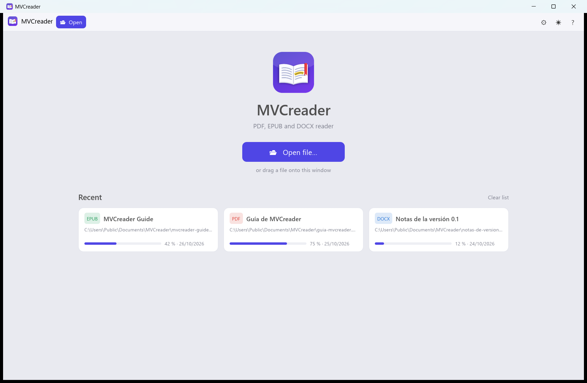
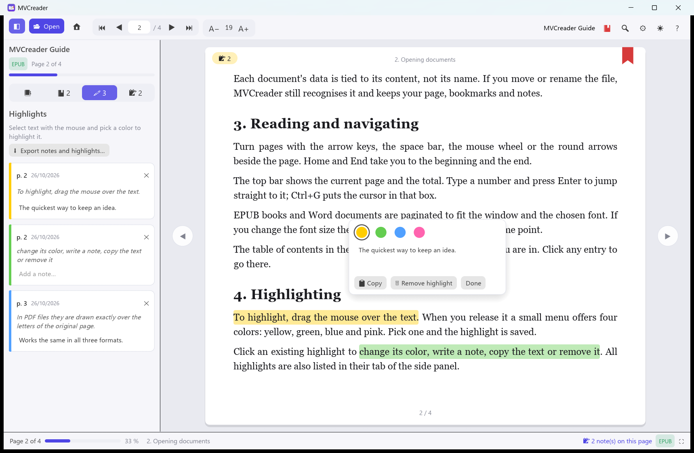
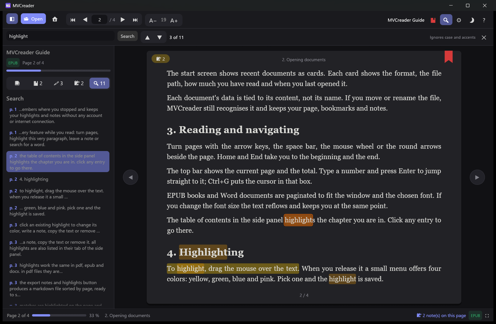
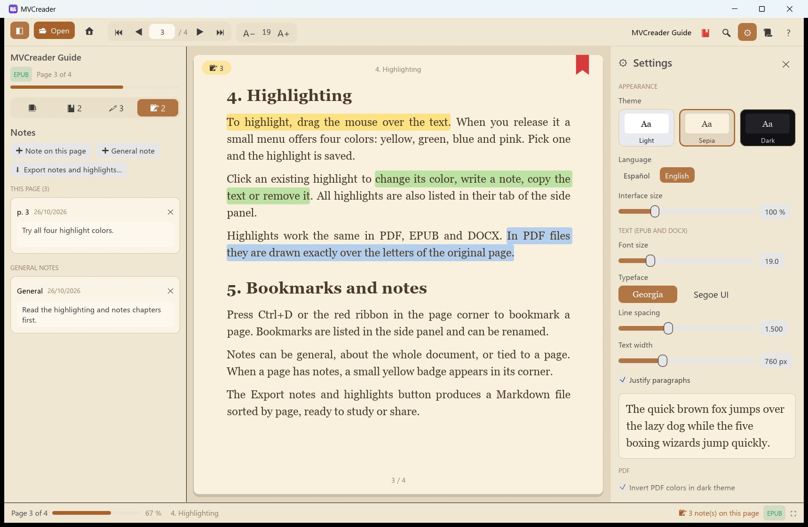
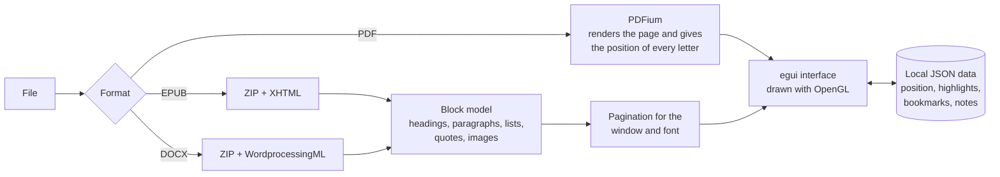

<p align="center">
  
</p>

<h1 align="center">MVCreader</h1>

<p align="center">
  A lightweight <b>PDF, EPUB and DOCX</b> reader for Windows: offline and with no accounts.<br>
  Highlights, bookmarks, notes and search in a single ~7 MB program.
</p>

<p align="center">
  <a href="README.md">Español</a> · <b>English</b>
</p>

<p align="center">
  
  
  
  
  
</p>



---

## 🤖 A *vibe coding* project

MVCreader was built with **vibe coding**: the code was not written by hand line by line, but
through a conversation with an AI assistant (Claude, by Anthropic, using Claude Code).

- **The person** defined what the program had to do, made the decisions (language, name, features,
  look), tested it with their own documents and pointed out what needed to change.
- **The AI** proposed the architecture, wrote the code, the automated tests, the icon and this
  documentation, and fixed the bugs that came up during testing.

The whole application (reading the three formats, pagination, highlights, search, bilingual
interface and icon) came out of that conversation in a single day. It shows what can be built this
way, and it is also a real project that can be used, read and improved.

## 💡 Why it was made

The goal was **one reader for the three most common document formats** that would:

1. Show the total number of pages and the current page.
2. Highlight text.
3. Add bookmarks.
4. Take notes, general or per page.
5. Remember the last page read in each file.
6. Offer a light or dark theme.
7. Let you adjust how the document looks.
8. Search for words with Ctrl+F.

With one extra condition: **use as few resources as possible**. That ruled out apps built with web
technologies (which ship a whole browser inside) and led to **Rust**, a compiled language as
efficient as C/C++ but safer.

## 🎯 Goals

- **Lightweight**: a native executable, instant startup and low memory use.
- **Private and offline**: no accounts, no cloud, no telemetry. Everything stays on your computer.
- **One place to read**: PDF, EPUB and DOCX with the same tools.
- **Your notes are yours**: stored as readable JSON and exportable to Markdown.
- **A base to grow on**: tidy, tested code ready for new features.

## 📸 Screenshots

| Reading and highlighting | Search (dark theme) |
|---|---|
|  |  |



## ✨ Features

- **Pages**: current and total page, progress bar and percentage; jump to a page by typing its
  number (Ctrl+G); arrows beside the page, keyboard and mouse wheel.
- **Highlighting** in four colors: drag the mouse over some text and pick a color. Click a highlight
  to change its color, add a note, copy it or remove it.
- **Bookmarks** with Ctrl+D or the ribbon in the page corner; they can be renamed.
- **Notes**, general or per page, plus notes on each highlight. Exportable to Markdown.
- **Remembers where you stopped** in each file, even if you move or rename it.
- **Light, sepia and dark themes** (in dark mode PDF pages are inverted; optional).
- **Reading settings**: zoom and fit to width or page for PDF; font size and typeface, line spacing,
  column width and justification for EPUB/DOCX, with a live preview.
- **Search (Ctrl+F)** ignoring case and accents, with results shown in context.
- **Table of contents**, **recent files** with progress, drag and drop, full screen (F11).
- **Spanish and English interface** (the first time it follows the Windows language).

Press **F1** inside the program to see every keyboard shortcut.

## ⚙️ How it works



- **Interface**: [egui](https://github.com/emilk/egui), an immediate-mode GUI library that draws
  straight on the graphics card. It only redraws when something changes, so it uses almost no CPU at rest.
- **PDF**: [PDFium](https://pdfium.googlesource.com/pdfium/) (Chrome's PDF engine) through
  `pdfium-render`. Only visible pages are rendered and only a few are cached. Each page also gives
  the position of every letter, which is used to select, highlight and search.
- **EPUB and DOCX**: both are ZIP files with XML inside. They are parsed into a list of blocks
  (headings, paragraphs, lists, quotes, images) that is paginated for the window size and font. To
  save memory only the height of each line is kept, and the visible text is laid out again when drawn.
- **Stable positions**: every highlight, note or bookmark is stored as *(block or page, character)*,
  so it stays in place even when you change the font size and the book is paginated again.
- **Recognising files**: each document is identified by a fingerprint of its content (size plus
  the first and last 64 KB), not by its name or path.
- **Search**: text is normalised letter by letter (lowercase, no accents), so matches point straight
  at the original text. In large PDF files search runs in small steps so the window never freezes.

## 📦 Usage

Copy the `dist\MVCreader` folder (or the release folder) anywhere and run `MVCreader.exe`.
`pdfium.dll` must stay next to the executable; it is only used to open PDF files.

Data is stored in `%APPDATA%\MVCreader`. **Portable mode**: if there is a folder named `datos`
next to `MVCreader.exe`, everything is stored there instead.

The [`samples/`](samples) folder has example documents (a guide to the program itself as EPUB, PDF
and DOCX) to try it out.

## 🛠️ Building

Requirements:

1. Rust with the GNU toolchain: `rustup-init.exe --default-host x86_64-pc-windows-gnu`
2. Full MinGW-w64 (provides the assembler used by `dlltool`, and `windres`, which embeds the icon):
   `winget install BrechtSanders.WinLibs.POSIX.UCRT`

```powershell
.\build.ps1
```

The script downloads PDFium (build `chromium/7881` from
[pdfium-binaries](https://github.com/bblanchon/pdfium-binaries)) if it is not in `vendor\`, builds
in release mode and leaves the result in `dist\MVCreader`.

Other scripts:

- `python assets/make_icon.py`: regenerates the icon (requires Pillow).
- `python samples/make_samples.py`: regenerates the sample documents (the PDF is printed with Microsoft Edge).

### Tests

The tests open real documents and drive the interface without a window: selecting, highlighting,
taking notes, bookmarking, searching, changing the font and reopening. Copy `pdfium.dll` to
`target\release\deps` for the PDF test.

```powershell
$env:LECTOR_EPUB = "samples\mvcreader-guide.epub"
$env:LECTOR_PDF  = "samples\guia-mvcreader.pdf"
$env:LECTOR_DOCX = "samples\notas-de-version.docx"
cargo test --release -- --test-threads=1
```

## 🗂️ Project layout

| File | Contents |
|---|---|
| `src/main.rs` | Window and startup |
| `src/app.rs` | App state: opening and saving, search, keyboard |
| `src/app/panels.rs` | Top bar, side panel, start screen, settings, help, notifications |
| `src/app/view.rs` | Page drawing, selection, highlights and pop-up menu |
| `src/i18n.rs` | Interface text in Spanish and English |
| `src/theme.rs` | Theme colors and style |
| `src/store.rs` | JSON persistence |
| `src/search.rs` | Text normalisation and search |
| `src/doc/pdf.rs` | PDF through PDFium |
| `src/doc/flow.rs` | EPUB/DOCX text model and pagination |
| `src/doc/epub.rs`, `docx.rs` | Format readers |
| `build.rs`, `assets/` | Executable icon and version info |

## ⚠️ Known limitations (v0.1)

- EPUB and DOCX are shown with MVCreader's own styling: the book's CSS and Word's exact formatting are not applied.
- Password-protected PDF files cannot be opened yet.
- Windows only.
- The interface uses OpenGL: at rest it takes about 100 MB of RAM, mostly the graphics driver.

## 📄 License

MVCreader is released under the [MIT license](LICENSE).

PDFium is distributed under its own licenses (BSD-3-Clause and those of its components), which are
included next to the executable (`LICENCIA-PDFIUM.txt` and the `licencias-terceros` folder).
