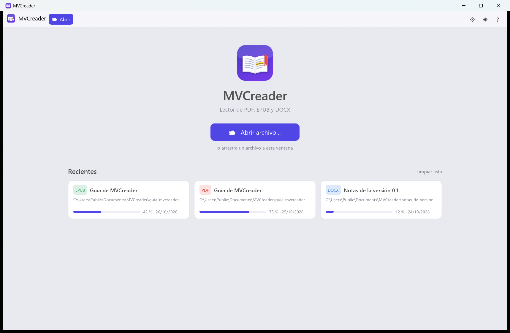
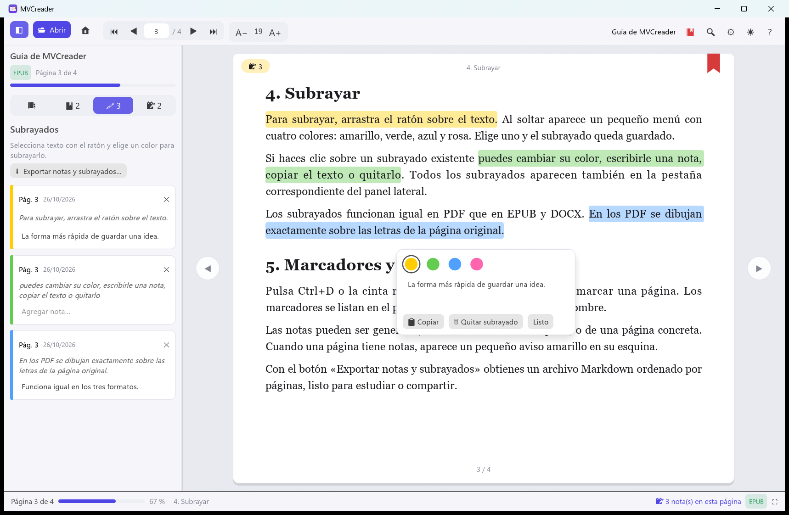
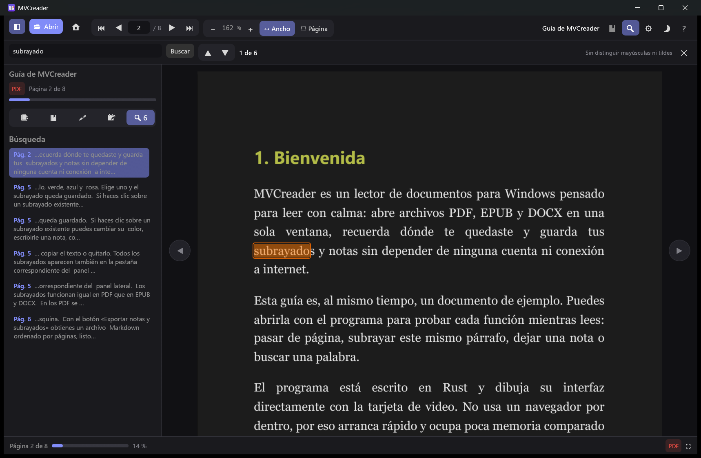
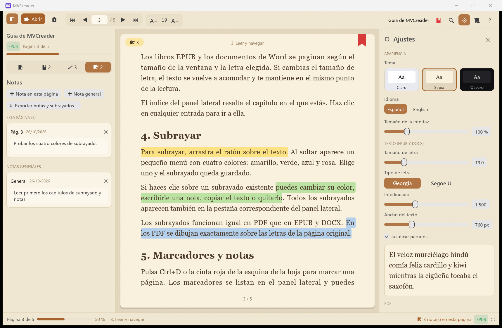
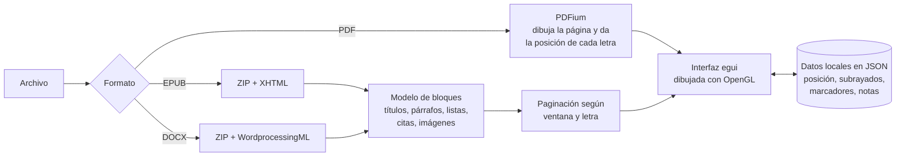

<p align="center">
  
</p>

<h1 align="center">MVCreader</h1>

<p align="center">
  Lector de documentos <b>PDF, EPUB y DOCX</b> para Windows, liviano, sin conexión y sin cuentas.<br>
  Subrayados, marcadores, notas y búsqueda en un solo programa de ~7 MB.
</p>

<p align="center">
  <b>Español</b> · <a href="README.en.md">English</a>
</p>

<p align="center">
  
  
  
  
  
</p>



---

## 🤖 Un proyecto de *vibe coding*

MVCreader se hizo con **vibe coding**: el código no se escribió a mano línea por línea, sino
conversando con un asistente de IA (Claude, de Anthropic, a través de Claude Code).

- **La persona** definió qué tenía que hacer el programa, tomó las decisiones (lenguaje, nombre,
  funciones, aspecto), lo probó con sus propios documentos y señaló lo que había que cambiar.
- **La IA** propuso la arquitectura, escribió el código, las pruebas automáticas, el icono y esta
  documentación, y corrigió los errores que aparecieron al probar.

Toda la aplicación (lectura de los tres formatos, paginación, subrayados, búsqueda, interfaz
bilingüe e icono) salió de esa conversación en una sola jornada. Es una muestra de lo que se puede
construir así, y también un proyecto real que se puede usar, leer y mejorar.

## 💡 Por qué se hizo

Hacía falta **un solo lector para los tres formatos más comunes** que cumpliera con esto:

1. Mostrar el número de páginas totales y la página actual.
2. Subrayar texto.
3. Poner marcadores.
4. Escribir notas, generales o por página.
5. Recordar la última página leída de cada archivo.
6. Elegir entre tema claro u oscuro.
7. Ajustar cómo se ve el documento.
8. Buscar palabras con Ctrl+F.

Y con una condición extra: **consumir la menor cantidad de recursos posible**. Por eso se descartaron
las aplicaciones hechas con tecnologías web (que cargan un navegador completo por dentro) y se eligió
**Rust**, un lenguaje compilado tan eficiente como C/C++ pero más seguro.

## 🎯 Objetivo

- **Liviano**: un ejecutable nativo, arranque inmediato y poca memoria.
- **Privado y sin conexión**: no hay cuentas, nube ni telemetría. Todo se guarda en tu equipo.
- **Un solo lugar para leer**: PDF, EPUB y DOCX con las mismas herramientas.
- **Tus notas son tuyas**: se guardan en JSON legible y se pueden exportar a Markdown.
- **Base para crecer**: código ordenado y con pruebas, listo para nuevas funciones.

## 📸 Capturas

| Leer y subrayar | Buscar (tema oscuro, PDF) |
|---|---|
|  |  |



## ✨ Funciones

- **Páginas**: página actual y total, barra de progreso y porcentaje; ir a una página escribiendo
  el número (Ctrl+G); flechas a los lados de la hoja, teclado y rueda del ratón.
- **Subrayado** en cuatro colores: arrastra el ratón sobre el texto y elige un color. Haz clic en
  un subrayado para cambiarle el color, anotarlo, copiarlo o quitarlo.
- **Marcadores** con Ctrl+D o con la cinta de la esquina de la página; se pueden renombrar.
- **Notas** generales o de una página, y notas sobre cada subrayado. Se exportan a Markdown.
- **Recuerda dónde quedaste** en cada archivo, incluso si lo mueves o le cambias el nombre.
- **Temas** claro, sepia y oscuro (en oscuro, las páginas PDF se invierten; es opcional).
- **Ajustes de lectura**: zoom y ajuste al ancho o a la página en PDF; tamaño y tipo de letra,
  interlineado, ancho de columna y justificado en EPUB/DOCX, con vista previa.
- **Búsqueda (Ctrl+F)** sin distinguir mayúsculas ni tildes, con resultados en contexto.
- **Índice** del documento, **recientes** con su progreso, arrastrar y soltar, pantalla completa (F11).
- **Interfaz en español e inglés** (la primera vez toma el idioma de Windows).

Pulsa **F1** dentro del programa para ver todos los atajos de teclado.

## ⚙️ Cómo funciona



- **Interfaz**: [egui](https://github.com/emilk/egui), una biblioteca de interfaz en modo inmediato
  que dibuja directamente con la tarjeta de video. Solo redibuja cuando algo cambia, así que en
  reposo prácticamente no usa CPU.
- **PDF**: se usa [PDFium](https://pdfium.googlesource.com/pdfium/) (el motor de PDF de Chrome)
  mediante `pdfium-render`. Solo se dibujan las páginas visibles y se guardan pocas en caché. De cada
  página se obtiene la posición de cada letra, que sirve para seleccionar, subrayar y buscar.
- **EPUB y DOCX**: son archivos ZIP con XML por dentro. Se leen y se convierten en una lista de
  bloques (títulos, párrafos, listas, citas, imágenes) que se pagina según el tamaño de la ventana
  y de la letra. Para ahorrar memoria solo se guarda la altura de cada línea, y lo visible se vuelve
  a componer al dibujarlo.
- **Posiciones estables**: cada subrayado, nota o marcador se guarda como *(bloque o página,
  carácter)*. Por eso siguen en su sitio aunque cambies el tamaño de letra y el libro se vuelva a paginar.
- **Identificar archivos**: cada documento se reconoce por una huella de su contenido (tamaño y
  primeros y últimos 64 KB), no por su nombre ni su ruta.
- **Búsqueda**: el texto se normaliza letra por letra (minúsculas y sin tildes), así las coincidencias
  apuntan directo al texto original. En PDF grandes la búsqueda avanza por partes para no congelar la ventana.

## 📦 Uso

Copia la carpeta `dist\MVCreader` (o la del *release*) donde quieras y ejecuta `MVCreader.exe`.
`pdfium.dll` debe quedar junto al ejecutable; solo se usa para abrir PDF.

Los datos se guardan en `%APPDATA%\MVCreader`. **Modo portable**: si junto a `MVCreader.exe` existe
una carpeta `datos`, todo se guarda ahí.

En [`samples/`](samples) hay documentos de ejemplo (una guía del propio programa en EPUB, PDF y
DOCX) para probarlo.

## 🛠️ Compilar

Requisitos:

1. Rust con el toolchain GNU: `rustup-init.exe --default-host x86_64-pc-windows-gnu`
2. MinGW-w64 completo (aporta el ensamblador que usa `dlltool` y `windres`, que incrusta el icono):
   `winget install BrechtSanders.WinLibs.POSIX.UCRT`

```powershell
.\build.ps1
```

El script descarga PDFium (build `chromium/7881` de
[pdfium-binaries](https://github.com/bblanchon/pdfium-binaries)) si no está en `vendor\`, compila en
modo release y deja el resultado en `dist\MVCreader`.

Otros scripts:

- `python assets/make_icon.py`: vuelve a generar el icono (requiere Pillow).
- `python samples/make_samples.py`: vuelve a generar los documentos de ejemplo (el PDF se imprime con Microsoft Edge).

### Pruebas

Las pruebas abren documentos reales y manejan la interfaz sin ventana: seleccionar, subrayar,
anotar, marcar, buscar, cambiar la letra y reabrir. Copia `pdfium.dll` a `target\release\deps`
para la prueba de PDF.

```powershell
$env:LECTOR_EPUB = "samples\guia-mvcreader.epub"
$env:LECTOR_PDF  = "samples\guia-mvcreader.pdf"
$env:LECTOR_DOCX = "samples\notas-de-version.docx"
cargo test --release -- --test-threads=1
```

## 🗂️ Estructura

| Archivo | Contenido |
|---|---|
| `src/main.rs` | Ventana y arranque |
| `src/app.rs` | Estado de la app: abrir y guardar, búsqueda, teclado |
| `src/app/panels.rs` | Barra superior, panel lateral, inicio, ajustes, ayuda, avisos |
| `src/app/view.rs` | Dibujo de páginas, selección, subrayados y menú flotante |
| `src/i18n.rs` | Textos de la interfaz en español e inglés |
| `src/theme.rs` | Colores y estilo de los temas |
| `src/store.rs` | Persistencia en JSON |
| `src/search.rs` | Normalización y búsqueda de texto |
| `src/doc/pdf.rs` | PDF con PDFium |
| `src/doc/flow.rs` | Modelo de texto de EPUB/DOCX y paginación |
| `src/doc/epub.rs`, `docx.rs` | Lectores de cada formato |
| `build.rs`, `assets/` | Icono e información de versión del ejecutable |

## ⚠️ Limitaciones conocidas (v0.1)

- EPUB y DOCX se muestran con un estilo propio: no se aplica el CSS del libro ni el formato exacto de Word.
- Los PDF protegidos con contraseña todavía no se pueden abrir.
- Solo para Windows.
- La interfaz usa OpenGL: en reposo ocupa unos 100 MB de RAM, la mayor parte del driver de video.

## 📄 Licencia

MVCreader se distribuye bajo la [licencia MIT](LICENSE).

PDFium se distribuye bajo sus propias licencias (BSD-3-Clause y las de sus componentes); se incluyen
junto al ejecutable (`LICENCIA-PDFIUM.txt` y la carpeta `licencias-terceros`).
